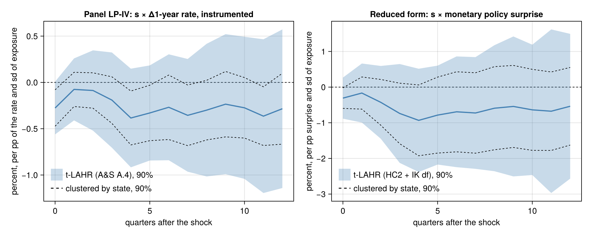

# PanelLocalProjections.jl

Panel local projections in Julia. For each horizon `h`, the package estimates a panel
regression of `y_{i,t+h}` on a shock, and gathers the estimators and inference
procedures of the recent panel-LP literature in one place:

| Method | Reference | Status |
|---|---|---|
| Fixed-effects (within/LSDV) panel LP, with unit-, time- and two-way-clustered, heteroskedasticity-robust and Driscoll–Kraay standard errors | Jordà (2005); Driscoll & Kraay (1998); Cameron, Gelbach & Miller (2011) | v0.1 |
| Split-panel jackknife (SPJ) correction of the Nickell bias of the FE estimator | Mei, Sheng & Shi (2026, *JIE*) | v0.1 |
| Cumulative-difference OLS (CD-OLS), which avoids the within transformation | Ugarte-Ruiz (2026, BBVA Research) | v0.1 |
| t-LAHR inference for aggregate (macro) shocks: time-clustered, lag-augmented, heteroskedasticity-robust, with an HC2 + Imbens–Kolesár refinement | Almuzara & Sancibrián (2026) | v0.1 |
| Panel LP-IV (2SLS, with lag augmentation and t-LAHR), with Kleibergen–Paap and Montiel Olea–Pflueger first-stage diagnostics | Almuzara & Sancibrián (2026, §3.4); Kleibergen & Paap (2006); Montiel Olea & Pflueger (2013) | v0.2 |

Version 0.2.0. What comes after it (joint bands across horizons, weak-IV-robust
inference, negative horizons) is listed in [`TODO.md`](TODO.md). The documentation covers the
methods, the conventions of each reference implementation and how `panellp` reproduces
them, the cross-checks, and audits of the reference code.

## Usage

```julia
using PanelLocalProjections

# Mei–Sheng–Shi: FE vs split-panel jackknife, unit-clustered standard errors
r   = panellp(@formula(leads(y) ~ x + lags(x, 1:4) + lags(y, 1:4) + fe(id)), data;
              id = :id, time = :year, horizon = 10, estimator = SplitPanelJackknife())
summarize(r, Clustered(:unit))

# Ugarte-Ruiz: cumulative-difference OLS
cd  = panellp(@formula(ldiff(y) ~ s + lags(s, 1)), data; id = :id, time = :year,
              horizon = 9, estimator = CDOLS())

# Almuzara–Sancibrián: aggregate shock X interacted with an exposure s, t-LAHR inference
as  = panellp(@formula(ldiff(logk) ~ lev & mp + lev + fe(firm) + fe(sector) & fe(quarter)),
              firms; id = :firm, time = :date, frequency = :quarter, horizon = 12,
              shock = "lev & mp", estimator = LagAugmented(ICLags()))
summarize(as, TLAHR(); level = 0.90)
```

## Example: monetary policy and US states

How much more does personal income fall in states more exposed to manufacturing after a
rise in the 1-year Treasury rate? The rate is instrumented by monetary policy surprises,
a panel LP-IV in Almuzara & Sancibrián's setting. The data are public: BEA state personal
income, FRED's 1-year rate (`GS1`), and the Jarociński–Karadi surprises.
`examples/us_states/build.jl` downloads them and builds the panel; the plot comes from
`examples/us_states/figure.jl`.

```julia
# ldiff(lpi): 100 × (log income_{t+h} − log income_{t−1}); s: 1998 manufacturing share
# (standardised); gs1: 1-year rate; mp: surprise; state and quarter effects
iv = panellp(@formula(ldiff(lpi) ~ (s & firstdiff(gs1) ~ s & mp) + fe(fips) + fe(t)), d;
             id = :fips, time = :t, horizon = 12, estimator = LagAugmented())
summarize(iv, TLAHR(refine = false); level = 0.90)    # t-LAHR for LP-IV (A&S A.4)
summarize(iv, Clustered(:unit); level = 0.90)         # clustered by state, for comparison
firststage(iv).kpF                                    # Kleibergen–Paap F, clustered by period

using CairoMakie
irfplot(summarize(iv, TLAHR(refine = false); level = 0.90))
```



Clustered by state, the responses look significant at several horizons. The t-LAHR bands
are 1.5 to 2.7 times wider, and none of them excludes zero. The first stage shows the same
thing: its Kleibergen–Paap F is about 2 clustered by period, but 35 robust and 200,000
clustered by state. The shock is aggregate, so the effective sample size is the 84
quarters, not the 4,284 state-quarters. See the
[example page](docs/src/examples/us_states.md) for the details.

Data: BEA Regional Economic Accounts; Board of Governors of the Federal Reserve System
(H.15), via FRED; Jarociński & Karadi (2020, *AEJ: Macroeconomics*), updated surprises
(CC BY 4.0). The data are not distributed with the package.

## Conventions

Leads, lags and differences are always computed on the (unit, calendar period) grid, so
gaps in a unit's time series are respected and nothing is shifted by row position. Every
convention on which reference implementations disagree is an explicit option, and each
is cross-checked against the reference that uses it: degrees-of-freedom factors,
singleton handling, two-way demeaning, the Driscoll–Kraay bandwidth and lag ordering, the
split-panel rule and critical values. The references are the Stata commands `xtlp`,
`reghdfe`, `xtscc`, `xtreg`, `locproj` and `xtspj`, R `fixest`, and the authors' own R and
MATLAB code.

## Acknowledgements and inspiration

The fixed-effect absorption, the OLS solver and every variance estimator are implemented
in this package. Their design takes inspiration from:

- [Regress.jl](https://github.com/gragusa/Regress.jl) and
  [CovarianceMatrices.jl](https://github.com/gragusa/CovarianceMatrices.jl) by Giuseppe
  Ragusa;
- [FixedEffectModels.jl](https://github.com/FixedEffects/FixedEffectModels.jl) by
  Matthieu Gomez;
- [LocalProjections.jl](https://github.com/gragusa/LocalProjections.jl) (and the
  [andrerecio fork](https://github.com/andrerecio/LocalProjections.jl)), whose formula
  interface (`leads`, `cumul`, `ldiff`, …) this package extends to panels;
- the Stata commands [`reghdfe`](https://github.com/sergiocorreia/reghdfe) (Sergio
  Correia) and [`xtlp`](https://github.com/shenshuuu/panel-local-projection-stata)
  (Mei, Sheng & Shi).

None of them is a dependency: the package depends only on StatsModels, Tables, StatsAPI,
StatsFuns, RecipesBase and Julia's standard library. Source files that adapt code from
these projects say so in a comment.

## Citing

If you use the package, please cite it together with the paper whose method you apply;
see [`CITATION.bib`](CITATION.bib).

- Mei, Z., Sheng, L. & Shi, Z. (2026). Nickell bias in panel local projection: Financial
  crises are worse than you think. *Journal of International Economics*, 104210.
- Ugarte-Ruiz, A. (2026). Panel local projections without fixed-effects: A
  cumulative-difference OLS estimator. BBVA Research.
- Almuzara, M. & Sancibrián, V. (2026). Micro responses to macro shocks. Working paper,
  July 2026; earlier version: Federal Reserve Bank of New York Staff Report No. 1090.

## License

MIT; see [`LICENSE`](LICENSE).
